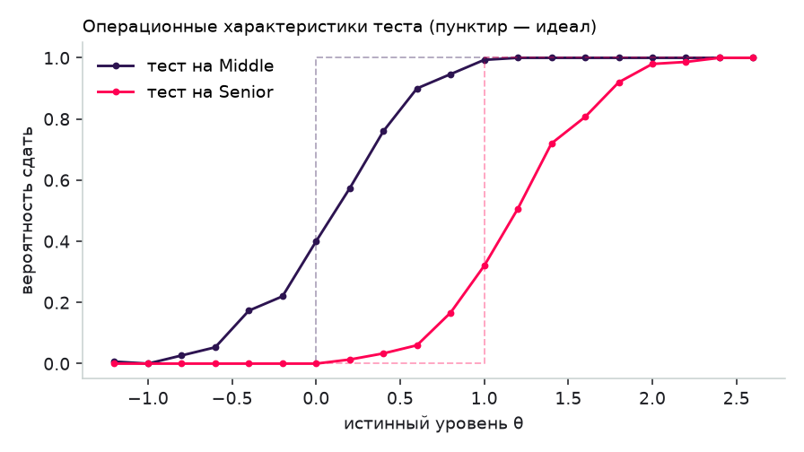
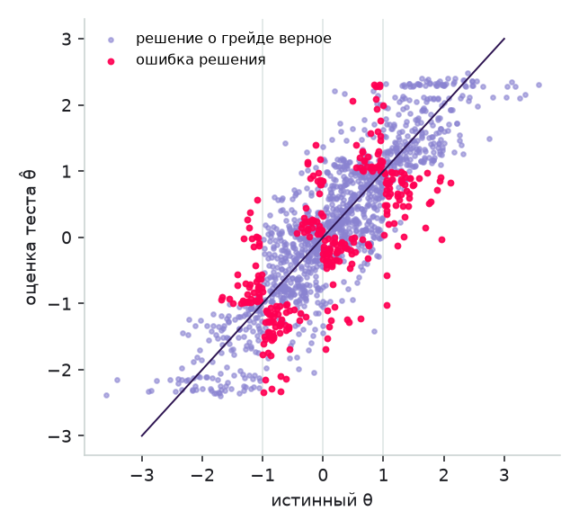
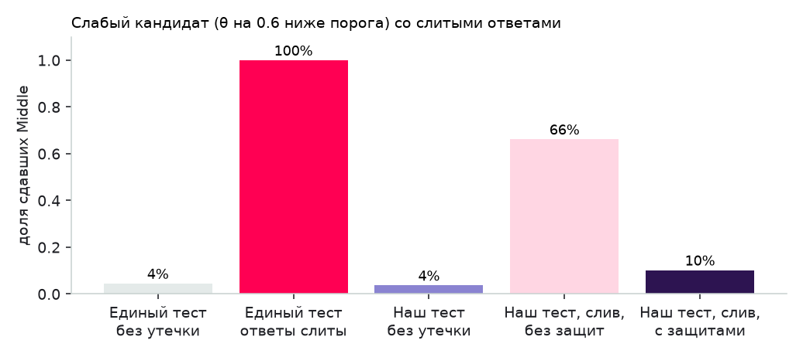
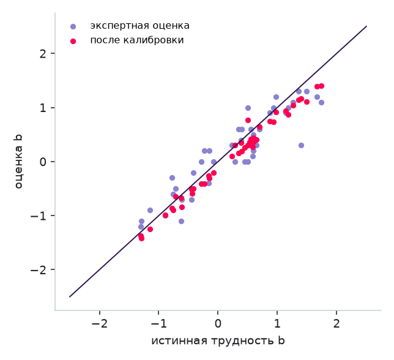
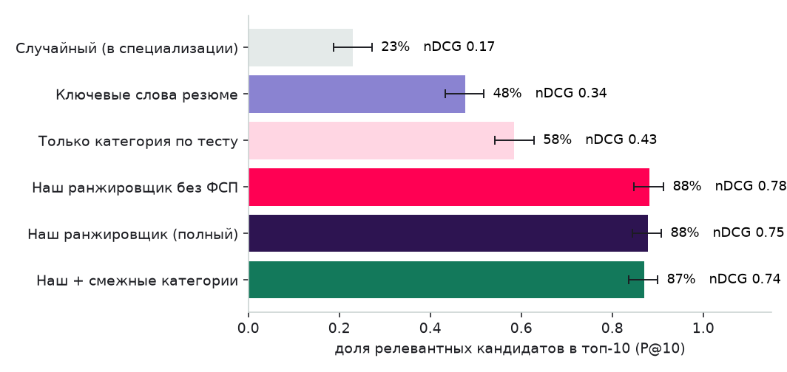
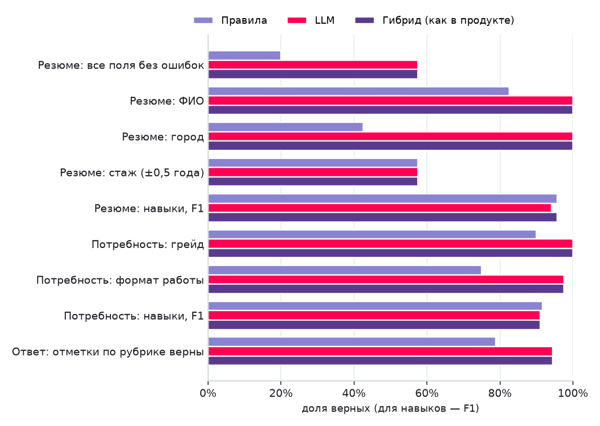

# ФСП Скаут — сопроводительная документация

Цифровая платформа подбора ИТ-специалистов с верифицированным профилем достижений участника Федерации
спортивного программирования. Спецтрек ФСП, ЛЦТ 2026. Команда «veni vidi vivii»: Кулешов Александр Сергеевич
(капитан), Доровской Иван Данилович.

Версия документа соответствует коду в репозитории. Все числа в разделе валидации воспроизводятся скриптами
из каталога `validation/`.

**Содержание**

- 1. Идея и обратная механика
- 2. Функциональная архитектура
  - 2.1. Роли и сценарии
  - 2.2. Сквозной сценарий
  - 2.3. Правила видимости (п. 2.2 ТЗ)
- 3. Компонентная архитектура
  - 3.1. Модель данных (основное)
  - 3.2. Безопасность и 152-ФЗ
- 4. Механика тестирования
  - 4.1. Требования и дилемма из ТЗ
  - 4.2. Решение: параметрические шаблоны + IRT + адаптивный тест
  - 4.3. Устойчивость к распространению заданий
  - 4.4. Сопоставимость сложности
  - 4.5. Оценки по навыкам с доказательствами
  - 4.6. Тест под вакансию
- 5. Механика подбора и категоризация
  - 5.1. Категоризация
  - 5.2. Потребность работодателя
  - 5.3. Ранжирование
  - 5.4. Обратная связь и дообучение
  - 5.5. Регулярные задания
- 6. Валидация
  - 6.1. Тестирование: точность, повторяемость, дискриминативность
  - 6.2. Устойчивость к распространению заданий
  - 6.3. Сопоставимость сложности и калибровка
  - 6.4. Подбор на наборе пар «вакансия — кандидат»
  - 6.5. Разбор резюме и потребностей, автооценка заданий: правила и локальная LLM
  - 6.6. Проверка на живых данных (19–24 октября и пилот с ФСП)
- 7. Интеграция с реестром ФСП
  - 7.1. Что получаем и как показываем
  - 7.2. Схема взаимодействия
  - 7.3. Переход на боевую систему
- 8. Описание API
  - 8.1. Перечень методов
- 9. Библиотеки и компоненты
- 10. Сборка, развёртывание и запуск
  - 10.1. Docker (рекомендуется)
  - 10.2. Без Docker
  - 10.3. Развёртывание на сервере
  - 10.4. Тесты и валидация
- 11. За рамками MVP: концепции
  - 11.1. Защита от фиктивных вакансий и недобросовестных работодателей
  - 11.2. Интеграция с ATS
  - 11.3. Дальнейшее развитие механик

## 1. Идея и обратная механика

На универсальных площадках кандидат откликается вслепую, а работодатель фильтрует сотни резюме по ключевым
словам. Резюме не подтверждает практическую компетентность, поэтому совпадение слов плохо предсказывает
совпадение навыков.

Платформа переворачивает процесс:

1. Кандидат проходит обязательный путь: опрос по направлению и специализации → самостоятельный выбор
   предполагаемого грейда → адаптивный тест на этот грейд. Результат теста — **категория**: связка
   специализации и грейда (например, «Бэкенд-разработка, Middle»). Резюме на категорию не влияет.
2. Работодатель описывает потребность своими словами. Система разбирает текст в требования, показывает
   подходящие категории (сколько в них людей, какие у них зарплатные ожидания) и ранжированный список
   кандидатов, где каждое место объяснено.
3. Работодатель сам выходит на конкретного человека: отправляет **приглашение** с описанием предложения,
   обязательной зарплатной вилкой и способом связи. Кандидат видит условия до начала общения.
   Его контакты открываются только после того, как он примет приглашение.

Достижения ФСП — независимое подтверждение навыков. Они поднимают кандидата внутри категории, но не
определяют её: кандидат без истории ФСП получает категорию на общих основаниях.

Самостоятельный отклик на вакансию, регулярные короткие задания от работодателей, адаптивная вёрстка и
обратная связь по отказам реализованы как дополнительный функционал.

## 2. Функциональная архитектура

### 2.1. Роли и сценарии

| Роль | Ключевые сценарии |
|---|---|
| Кандидат | Регистрация по email с подтверждением; опрос; адаптивный тест; категория и грейд с историей; загрузка PDF-резюме с автораспознаванием; стандартизированный PDF-профиль; привязка ФСП ID; приглашения (принять / отклонить с причиной); вакансии и отклики; регулярные задания; приватность и согласия |
| Работодатель | Профиль компании; потребность текстом → требования; рекомендованные категории; подборка с объяснением и фильтрами, которые не теряют закреплённых кандидатов; поиск по всей базе; карточка с доказательствами навыков; приглашения со статусами; вакансии и отклики; чертёж теста под вакансию; короткие задания; аналитика отказов |
| Администратор | Сводная статистика; банк заданий с параметрами IRT и предпросмотром экземпляров; черновики заданий от LLM; калибровка; модель ранжирования и её дообучение; журнал действий и писем |

### 2.2. Сквозной сценарий

```
Кандидат: регистрация → письмо → подтверждение → опрос → тест на заявленный грейд
          ├─ сдал уверенно → категория + предложение попробовать грейд выше
          ├─ сдал → категория
          └─ не сдал → «принять грейд ниже по этому результату» или «тест на грейд ниже»
                       (ответы первой попытки учитываются; грейд не понижается принудительно)
Работодатель: потребность текстом → требования → подходящие категории → подборка с объяснением
          → карточка с доказательствами → приглашение с вилкой
Кандидат: приглашение «отправлено» → «просмотрено» → «принято» (контакты раскрыты) | «отклонено» + причина
Работодатель: видит статус, контакты или причину отказа; подсказки по вилке и требованиям
```

### 2.3. Правила видимости (п. 2.2 ТЗ)

- Зарплатная вилка «от–до» в рублях обязательна в вакансии и в приглашении. API отвечает 422, если её нет.
- Приглашение содержит описание, вилку, название компании и способ связи.
- Контакты кандидата (ФИО целиком, email, телефон, Telegram) работодатель видит только при принятом
  приглашении этой компании или при отклике кандидата на её вакансию. Каждое раскрытие пишется в журнал.
- Кандидат видит только свои приглашения и отклики. Запрос чужого объекта возвращает 404 и не раскрывает
  факт его существования.
- Статусы приглашений: отправлено → просмотрено → принято / отклонено / отозвано. Статусы откликов:
  отправлено → просмотрено → приглашение к общению / отказ / отозван. Обе стороны видят актуальный статус и
  историю изменений.
- Регистрация — по email с подтверждением. Без подтверждения вход невозможен (403).

## 3. Компонентная архитектура

```
 ┌────────────────────┐        ┌──────────────────────────────────────────────┐
 │  Браузер (обе роли)│ HTTPS  │  frontend · Next.js 15 (React 19, TypeScript)│
 │                    ├───────►│  страницы кабинетов, прокси /api → backend   │
 └─────────┬──────────┘        └───────────────────────┬──────────────────────┘
           │ редирект OIDC (вход ФСП ID)               │ /api/v1/*
           ▼                                           ▼
 ┌────────────────────┐  OIDC + реестр  ┌──────────────────────────────────────┐
 │ ФСП ID / реестр    │◄────────────────┤  backend · FastAPI (модульный монолит)│
 │ (fsp-mock; в бою — │  client creds,  │  api/        роутеры, OpenAPI        │
 │  Keycloak + API    │  JWKS, подписи  │  services/testing   банк, IRT, CAT   │
 │  реестра ФСП)      │                 │  services/matching  ранжирование, LTR│
 └────────────────────┘                 │  services/fsp       клиент ФСП       │
                                        │  services/llm       провайдеры LLM   │
 ┌────────────────────┐  OpenAI API     │  services/resume    PDF ↔ поля       │
 │ LLM (необязательно)│◄────────────────┤  services/nlp       разбор на правилах│
 │ локальная модель   │                 └───────────────────┬──────────────────┘
 └────────────────────┘                                     │ SQLAlchemy 2, Alembic
                                                            ▼
                                              ┌────────────────────────────┐
                                              │ PostgreSQL 16              │
                                              └────────────────────────────┘
```

| Компонент | Ответственность | Технологии |
|---|---|---|
| `frontend` | Кабинеты кандидата, работодателя и администратора; проксирует `/api` на бэкенд, поэтому cookie сессии остаётся first-party | Next.js 15, React 19, TypeScript, Tailwind CSS, SWR |
| `backend/app/api` | REST API, валидация входных данных (Pydantic), разграничение прав по ролям, OpenAPI | FastAPI |
| `services/testing` | Банк параметрических шаблонов, IRT-модель, адаптивный тест, калибровка, оценки по навыкам | NumPy |
| `services/matching` | Разбор потребности, каталог категорий, ранжирование с объяснением, аналитика отказов, дообучение весов | NumPy |
| `services/fsp` | OIDC-клиент (PKCE), клиент реестра, проверка подписей достижений, перевод достижений в сигналы | httpx, PyJWT |
| `services/llm` | Единый интерфейс к LLM: локальный OpenAI-совместимый сервер (llama.cpp, Ollama, vLLM) или работа без LLM | httpx |
| `services/resume`, `services/nlp` | Разбор PDF-резюме и текстов на правилах (+ LLM); генерация стандартизированного PDF-профиля | pypdf, ReportLab |
| `fsp-mock` | Эмуляция ФСП ID (URL-схема Keycloak) и реестра достижений с подписью RS256 | FastAPI, PyJWT |
| PostgreSQL | Хранение; схема — миграциями Alembic | PostgreSQL 16 |

Архитектура — модульный монолит с явными слоями: роутеры не содержат бизнес-логики, сервисы не зависят от
HTTP. Логика теста (`cat.py`, `irt.py`) и ранжирования (`ranker.py`) — чистые функции без БД. Поэтому
валидация гоняет ровно тот же код, что работает в продукте. Любой сервис можно вынести в отдельный процесс без
переписывания: тестирование и подбор общаются с остальным кодом через узкие интерфейсы.

### 3.1. Модель данных (основное)

| Сущность | Назначение |
|---|---|
| `users`, `email_tokens`, `consents` | Учётные записи, подтверждение почты, история согласий (152-ФЗ) |
| `candidate_profiles` | Резюме (самоописание), результаты опроса, **категория и θ по тесту**, оценки навыков с доказательствами, условия, кэш достижений ФСП, приватность |
| `survey_responses`, `grade_history` | История опросов и смен грейда |
| `item_templates` | Шаблоны заданий: параметры IRT (a, b, c), статус (черновик → претест → рабочий → выведен), число вариантов, статистика показов |
| `test_attempts`, `item_responses` | Попытки и показанные экземпляры: seed, отпечаток, текст для кандидата, ключ (на клиент не уходит), ответ, время |
| `companies`, `needs`, `shortlist` | Компании, потребности, закреплённые в подборке кандидаты |
| `invitations`, `vacancies`, `applications`, `status_events` | Приглашения, вакансии, отклики, история статусов |
| `regular_tasks`, `task_assignments` | Короткие задания и ответы |
| `ranking_models` | Версии весов ранжирования и метрики их обучения |
| `audit_log`, `outbox_emails` | Журнал значимых действий и отправленных писем |

### 3.2. Безопасность и 152-ФЗ

- **Пароли** — Argon2id. **Сессия** — JWT в cookie `HttpOnly; SameSite=Lax` (`Secure` за HTTPS), JavaScript
  страницы к токену доступа не имеет. Для внешних клиентов тот же токен принимается как
  `Authorization: Bearer`.
- **Подтверждение почты** — одноразовый токен. В БД хранится только SHA-256 токена, срок жизни — 48 часов.
- **Ограничение частоты** попыток входа (429).
- **Разграничение прав** по ролям на уровне зависимостей FastAPI. Доступ к объектам проверяется по владельцу;
  для чужих объектов ответ 404.
- **Согласия:** на обработку ПДн (обязательно при регистрации), на показ профиля работодателям, на получение
  данных ФСП. Каждое изменение сохраняется с датой, версией текста и IP. Отзыв согласия на показ сразу убирает
  кандидата из выдачи.
- **Минимизация данных:** до принятия приглашения работодатель видит обезличенное имя («Иван И.»), город,
  категорию и оценки навыков — без контактов. Поля, которые видит работодатель, кандидат настраивает сам.
- **Право на удаление:** `DELETE /auth/me` каскадно удаляет профиль и связанные данные.
- **Журнал** раскрытий контактов, смен грейда, привязок ФСП и изменений согласий.
- **LLM без утечки ПДн:** по умолчанию LLM выключена. Если включена — только локальная модель на своём
  сервере (llama.cpp, Ollama), тексты никуда не передаются. Контакты из резюме извлекаются регулярными
  выражениями, LLM для них не требуется.
- Ключ ответа на задание хранится только на сервере и никогда не отдаётся клиенту во время теста.

## 4. Механика тестирования

### 4.1. Требования и дилемма из ТЗ

Единый набор заданий для всех быстро расходится между кандидатами. Уникальные задания, сгенерированные
нейросетью под каждого, не гарантируют сопоставимой сложности и объективности. Нужен подход, устойчивый к
обеим проблемам. Кроме того, тест должен давать стабильный грейд при повторном прохождении и разделять
слабых и сильных.

### 4.2. Решение: параметрические шаблоны + IRT + адаптивный тест

**Параметрический шаблон** — генератор задания. Из случайного seed он строит экземпляр: новые числа,
таблицы, код, имена, порядок вариантов. Правильный ответ вычисляется самим генератором (для заданий с кодом —
выполнением или моделированием сгенерированного кода), а не хранится в банке. Экземпляры одного шаблона
**изоморфны**: у них одна структура решения и одна трудность, а ответ разный.

Примеры: «сколько строк вернёт `GROUP BY … HAVING`» на случайной таблице; «в каком порядке выведутся строки»
для случайной комбинации `setTimeout`, `Promise.then` и синхронного кода; «с какой инструкции начнётся
пересборка образа» для случайного Dockerfile; «каким цветом будет текст» для случайного набора CSS-правил.

В банке **84 шаблона** по пяти специализациям (бэкенд, фронтенд, Data Science / ML, DevOps / SRE, QA) и
общим темам (алгоритмы, SQL, HTTP, Git, безопасность). Форматы: выбор одного ответа, выбор нескольких,
ввод ответа. Каждый шаблон размечен навыками с весами. По ним строятся оценки навыков с доказательствами.

**Модель IRT (3PL).** Вероятность верного ответа: `P(θ) = c + (1 − c) / (1 + e^(−a(θ − b)))`, где θ —
способность кандидата, b — трудность шаблона, a — дискриминативность, c — вероятность угадать (1/число
вариантов; 0 для ввода ответа). Трудность задаётся на уровне шаблона, поэтому все кандидаты, получившие его
варианты, оцениваются на одной шкале.

**Грейды — пороги на шкале θ:** Junior ≥ −1, Middle ≥ 0, Senior ≥ 1 (стажёр — ниже −1).

**Адаптивный тест (CAT):**

1. Оценка θ̂ и её стандартной ошибки — EAP (апостериорное среднее) на сетке. Устойчива с первых ответов.
2. Следующее задание выбирается по трём правилам. Баланс содержания: навык, сильнее всего отстающий от
   «чертежа» теста. Внутри него — максимум информации Фишера в θ̂. Контроль экспозиции: случайный выбор из
   четырёх лучших (randomesque).
3. Остановка: интервал θ̂ ± 1.645·SE целиком выше или ниже порога заявленного грейда (решение принято с
   односторонней уверенностью 95%); иначе — максимум 25 заданий (минимум 8).
4. Итог: прошёл ли заявленный грейд, вероятность того, что уровень выше порога, предложения дальнейших
   шагов.

**Правила грейда:**

- Сдал — получает заявленный грейд. Сдал уверенно — система сразу предлагает попробовать грейд выше.
- Не сдал — грейд **не понижается принудительно**. Кандидат может принять грейд ниже по этому же результату
  (если интервал уверенно выше порога нижнего грейда) или сразу пройти тест на уровень ниже. Во втором тесте
  учитываются ответы первой попытки: тот же человек в тот же день. Это сокращает второй тест и делает решение
  точнее.
- Смена грейда — не чаще раза в **90 дней**. Повторная попытка на тот же грейд — через **14 дней**. Незавершённый
  тест продолжается с того же места. Досрочное завершение засчитывает оставшееся как неверное, поэтому
  «бросить неудачно начатый тест» нельзя.

### 4.3. Устойчивость к распространению заданий

Защита многослойная. Вклад каждого слоя измерен в разделе 6.

1. **Уникальность экземпляров.** Медианное число различных экземпляров шаблона — более тысячи на 1500
   случайных seed, у большинства шаблонов — практически неограниченно. Слитый ответ к чужому варианту не
   подходит: структура та же, ответ другой.
2. **Журнал показов и свежие экземпляры.** У каждого показанного экземпляра хранится отпечаток (хэш текста,
   кода и правильного ответа). При генерации система перебирает seed и выбирает экземпляр, который ещё никому
   не показывался. База «вопрос → ответ», собранная из прошлых прохождений, не встретит совпадений.
3. **Не больше одного концептуального вопроса на тест.** Вопросы на понимание с небольшим пулом сценариев
   («какой код ответа уместен…», «какой уровень изоляции…») полезны, но их проще всего собрать в шпаргалку.
4. **Проверка согласованности ответов (person-fit, статистика lz).** Если человек решает трудные задания и
   проваливает лёгкие, паттерн неправдоподобен. Грейд не присваивается до короткого подтверждающего теста —
   только из шаблонов с практически неограниченной вариативностью. У честных кандидатов флаг срабатывает
   примерно в 1% случаев.
5. **Банк растёт и калибруется.** LLM предлагает новые шаблоны под навыки вакансий. Они проходят экспертное
   ревью, затем показываются как незачётные (претест) внутри реальных тестов — кандидат не отличает их от
   зачётных. После накопления ответов параметры оцениваются, и шаблон переходит в рабочий банк. Так новые
   задания не ломают сопоставимость.

### 4.4. Сопоставимость сложности

Сложность задаётся шаблоном, а не экземпляром. Экспертная стартовая оценка (a, b) уточняется калибровкой:

- **Претест-задания** — оценка (a, b) методом Ньютона по правдоподобию 3PL при известных θ отвечавших
  (эндпоинт `POST /admin/items/calibrate`).
- **Полная перекалибровка банка** — маргинальное правдоподобие, EM-алгоритм Бока–Эйткина по разреженной
  матрице ответов адаптивных тестов (`irt.calibrate`).

Чем это лучше «уникальных заданий от нейросети»: у LLM-задания трудность заранее неизвестна, и каждый
кандидат получает свою «линейку». У шаблона трудность одна на все экземпляры и измерена по ответам. Разница
численно показана в разделе 6.

### 4.5. Оценки по навыкам с доказательствами

Для каждого навыка — EAP по ответам на задания с этим навыком за 365 дней. Вклад задания взвешивается
весом навыка в шаблоне, априор центрирован на общем θ кандидата. Шкала 0–100 для людей
(θ = 0 → 50, θ = 1 → 73, θ = 2 → 88). Уверенность — по стандартной ошибке. При 1–2 заданиях оценка
помечается как предварительная.

Работодатель видит не только «Python 81/100», но и доказательства: какие задания решал кандидат, их
трудность, верно или нет. Может открыть конкретный экземпляр с ответом кандидата. Показ не раскрывает банк:
экземпляр уникален.

### 4.6. Тест под вакансию

По описанию вакансии строится «чертёж» теста: обязательные навыки весят 2, желательные 1, остальное ядро
специализации 0.5. Адаптивный алгоритм подбирает задания в этих пропорциях у порога грейда вакансии.
Работодатель видит чертёж, число откалиброванных шаблонов по каждому навыку и три экземпляра одного шаблона
для трёх разных кандидатов (`GET /employer/vacancies/{id}/test-blueprint`). Навыки без заданий в банке
подсвечиваются — для них LLM может предложить черновики.

## 5. Механика подбора и категоризация

### 5.1. Категоризация

Категория = специализация (из опроса) × грейд (из теста). Справочник: 5 специализаций в 4 направлениях,
32 навыка с синонимами для разбора текстов, 4 грейда. Смежные специализации (бэкенд ↔ DevOps, Data Science,
QA; фронтенд ↔ бэкенд) и соседние грейды используются, только если работодатель их разрешил — с пониженным
весом.

### 5.2. Потребность работодателя

Текст («нужен middle Python-разработчик в платёжный сервис: SQL, Docker, будет плюсом Kafka, 250–340 тыс.,
удалённо») разбирается в структуру: специализация, грейд(ы), обязательные навыки, желательные (всё после
«будет плюсом / желательно»), формат, город, вилка. Работает на правилах и, при подключённой LLM, на модели.
Результат правит человек. По потребности система показывает **рекомендованные категории**: размер,
сколько кандидатов закрывают требования, медиана и квартили зарплатных ожиданий, сколько с достижениями ФСП.

### 5.3. Ранжирование

В выдачу попадают кандидаты нужной категории, открытые к предложениям и давшие согласие на показ. Каждый
фактор нормирован в [0, 1], итог — взвешенная сумма × 100:

| Фактор | Что измеряет | Экспертный вес |
|---|---|---|
| Навыки под задачу | Для каждого требуемого навыка — сигмоида от (оценка по тесту − требуемая для грейда). SE расширяет переходную зону. Навык, подтверждённый только ФСП, — до 0.8; только в резюме — 0.25. Обязательные весят 2, желательные 1 | 0.38 |
| Грейд | Совпадение категории; соседний грейд — 0.4, смежная специализация — × 0.6 | 0.12 |
| Сила результата теста | Насколько θ выше порога своего грейда — ранжирование **внутри категории** | 0.18 |
| Достижения ФСП | Сила подтверждённых достижений с учётом релевантности дисциплины специализации | 0.12 |
| Актуальность профиля | Затухание с момента последнего теста или короткого задания (полупериод ~4 мес.) | 0.06 |
| Зарплатные ожидания | Пересечение вилки работодателя и ожиданий кандидата | 0.09 |
| Формат работы | Совпадение формата и города (с учётом удалёнки и релокации) | 0.05 |

**Объяснимость.** Для каждого кандидата формируются краткое резюме («обязательные навыки: подтверждено 5 из 5;
Python 81/100 по тесту (6 заданий); ФСП: продуктовое программирование, 2 место из 80»), плюсы и минусы, вклад
каждого фактора в баллах и доказательства по навыкам.

**Фильтры без потери подборки.** Работодатель уточняет выдачу (грейд, навыки с минимальной оценкой, ФСП,
формат, потолок ожиданий, «все обязательные подтверждены»). Закреплённые кандидаты при этом не пропадают:
если фильтр их скрывает, они возвращаются отдельным списком с пометкой. Сама подборка хранится на сервере.

**Поиск по всей базе** — те же фильтры по любой категории, сортировка по силе подтверждённого профиля
(тест 60%, ФСП 30%, актуальность 10%).

### 5.4. Обратная связь и дообучение

Отказ от приглашения требует причины: «зарплата ниже ожиданий», «не подходит стек», «не тот уровень»,
«формат или город», «компания», «не ищу работу». Из этого строится:

- **Подсказки работодателю.** Доля принятых приглашений, распределение причин, рекомендации. Например:
  «Бэкенд, Senior: медиана ожиданий 440 тыс. ₽, ваша вилка до 338 тыс. ₽ — на 23% ниже рынка категории».
- **Подсказки кандидату.** Какие навыки чаще всего требуют в его категории и какие из них у него не
  подтверждены тестом.
- **Дообучение весов (learning to rank).** Каждое приглашение хранит вектор факторов на момент отправки.
  Логистическая регрессия на исходах (принято/отклонено; «не ищу работу» исключается) оценивает, что реально
  влияет на согласие. Новые веса смешиваются с экспертными пропорционально объёму данных. Веса факторов
  соответствия (навыки, грейд, тест, ФСП) не опускаются ниже 80% экспертных: иначе модель начала бы показывать
  тех, кто охотно соглашается, а не тех, кто подходит. Качество проверяется ROC-AUC на отложенной выборке.

### 5.5. Регулярные задания

Работодатель создаёт короткую задачу «реши или предложи подход» с рубрикой (критерии и ключевые слова). Раз в
неделю система предлагает кандидату 1–2 задачи его специализации и грейда. Ответ оценивается автоматически:
по ключевым словам критериев, а при подключённой LLM модель уточняет оценку фоном: отмечает, выполнен ли
каждый критерий, а балл считается в коде по весам критериев. Балл — подсказка: работодатель видит отметки и ставит свою оценку
(качество обоих способов — п. 6.5). Сдача
задания обновляет актуальность профиля — фактор ранжирования.

## 6. Валидация


Готовых датасетов и эталонной разметки в рамках хакатона нет. Поэтому основная процедура — **симуляция с
известной истиной**. У каждого синтетического кандидата есть скрытый «истинный» уровень θ и уровни по
навыкам. Он проходит **тот же код** адаптивного теста и ранжирования, что работает в продукте, а ответы
генерируются моделью 3PL с параметрами, которые **отличаются** от известных системе (экспертная оценка
трудности ошибается в среднем на 0,33, дискриминативность — на 25%). Для экземпляров одного шаблона заложен
разброс трудности. Это проверяет механику в условиях, когда эксперт ошибся, а изоморфные варианты не идеально
равны. Всё воспроизводится: `validation/testing_study.py`, `matching_study.py`, `parsing_study.py`,
фиксированные seed.

Ограничение честно: симуляция проверяет механику, а не содержание конкретных заданий. Проверка на живых
людях описана в п. 6.6.

### 6.1. Тестирование: точность, повторяемость, дискриминативность

Кандидаты: 300 на каждую из 5 специализаций, θ ~ N(0,15; 1). Заявленный грейд — истинный с типичной
переоценкой (+0,25 ± 0,5). Каждый кандидат проходит тест **дважды** с новыми заданиями и экземплярами.
Порог решения — пройден ли заявленный грейд; «вдали от порога» — |θ − порог| ≥ 0,3. Итоговая категория —
весь путь как в продукте: тест → принять грейд ниже или тест ниже с учётом ответов первой попытки.

| Специализация | Шаблонов | Точность решения | вдали от порога | Повторяемость решения | κ Коэна | Итоговая категория = истинной | Повторяемость категории | Заданий в тесте |
|---|---|---|---|---|---|---|---|---|
| Бэкенд | 45 | 81% | 89% | 77% | 0,54 | 70% | 73% | 18.3 |
| Фронтенд | 29 | 78% | 89% | 73% | 0,42 | 74% | 70% | 20.0 |
| Data Science | 37 | 79% | 88% | 73% | 0,44 | 72% | 65% | 18.9 |
| DevOps | 38 | 82% | 93% | 76% | 0,49 | 73% | 76% | 19.3 |
| QA | 35 | 82% | 93% | 75% | 0,47 | 75% | 73% | 19.0 |
| **Среднее** | | **80%** | **91%** | **75%** | **0,47** | **73%** | **71%** | **19.1** |

- Итоговая категория отличается от истинной **не более чем на один грейд в 100%** случаев.
- Корреляция оценки θ̂ с истинным уровнем — **0,85**, RMSE 0,59. Между двумя
  независимыми прохождениями — 0,76.
- Ложные «сдал» среди тех, кто ниже порога, — 22%, ложные «не сдал» — 18%.
  Ошибки сосредоточены у самого порога: там любой тест конечной длины близок к монетке.
- **Дискриминативность заданий.** Точечно-бисериальная корреляция успеха в задании с итоговой оценкой: медиана
  **0,47**, выше 0,2 у **99%** шаблонов, выше 0,3 у
  94% (оценено 73 шаблонов с ≥ 30 ответами). Слабые
  шаблоны видны администратору и выводятся из банка. Разделение слабых и сильных относительно порога —
  ROC-AUC 0,74.
- **Ложные флаги person-fit** у честных кандидатов — 0,5%.



*Вероятность сдать тест в зависимости от истинного уровня. Чем круче кривая у порога, тем лучше тест
разделяет кандидатов; пунктир — идеальная ступенька.*



*Оценка теста против истинного уровня. Ошибки решения (розовые точки) — у вертикальных линий порогов.*

Конфигурация теста выбрана по симуляции (`validation/tune_cat.py`, `out/cat_tuning.json`). Выбор задания по
информативности у порога вместо текущей оценки и более мягкий порог уверенности дают различия в пределах
шума. Увеличение максимума с 20 до 25 заданий повышает точность вдали от порога. Ограничитель — объём
информации, а не алгоритм выбора. Поэтому дальнейший рост — за счёт более информативных заданий (ввод
ответа вместо выбора, a ≥ 1,5) и учёта ответов связанной попытки (уже сделано).

### 6.2. Устойчивость к распространению заданий

**Атака.** Платформа работает: 300 честных кандидатов проходят тест на Middle по бэкенду,
система ведёт журнал показанных экземпляров. Затем **все** их задания с правильными ответами
(5328 экземпляров) сливаются в общую базу. Слабый кандидат (истинный уровень на 0,6 ниже
порога Middle) проходит тест и отвечает верно на всё, что находит в базе, остальное — по своим силам.

| Сценарий | Доля сдавших Middle | Доля заданий, найденных в слитой базе |
|---|---|---|
| Единый тест для всех, без утечки | 4,5% | — |
| Единый тест для всех, ответы слиты | **100%** | 100% |
| Наш тест, без утечки | 3,7% | 4,4% |
| Наш тест, слив, только параметрические шаблоны (без журнала показов и лимитов) | 66% | 40% |
| **Наш тест, слив, все защиты** | **10%** | 9% |

Итог: прирост доли сдавших от слива — **+6 п. п.** против
+96 п. п. у единого теста. Два случайных
кандидата получают задания одних и тех же шаблонов в 67% случаев, но один и тот же
**экземпляр** — в 0.1% случаев. Медиана различных экземпляров на шаблон —
1388 (на 1500 seed; у большинства — практически без ограничений).

Остаточный эффект — от вопросов на понимание с небольшим пулом сценариев (10
из 45 шаблонов бэкенда): их допускается не больше одного на тест. Расширение этих пулов
перефразированием через LLM с калибровкой — следующий шаг.



### 6.3. Сопоставимость сложности и калибровка

Пул бэкенда, 3000 симулированных прохождений (62533 ответов) плюс по три
незачётных претест-задания на кандидата. Параметры шаблонов оцениваются EM-алгоритмом маргинального
правдоподобия.

- Трудность: корреляция с истинной — экспертная оценка **0,92**, после калибровки
  **0,99**. RMSE 0,33 → 0,18.
- Дискриминативность после калибровки: корреляция с истинной 0,88.

| Условие | Точность решения | Повторяемость | Корр. θ̂ и θ |
|---|---|---|---|
| Параметрические шаблоны, экспертные параметры | 76% | 73% | 0,85 |
| Параметрические шаблоны после калибровки (MML-EM) | 75% | 73% | 0,87 |
| Идеально известные параметры (верхняя граница) | 80% | 77% | 0,87 |
| Уникальные задания без калибровки (разброс трудности 0.7) | 77% | 72% | 0,83 |

«Уникальные задания без калибровки» моделируют подход «нейросеть генерирует задания под каждого»: трудность
каждого экземпляра отклоняется от предполагаемой со стандартным отклонением 0,7. В этой симуляции разница в
точности решения невелика: адаптивный тест частично компенсирует случайный разброс. Но такой подход теряет
главное — **измеримость**: трудность задания неизвестна, её нельзя проверить, а у кандидатов оказываются
разные «линейки». В подходе с шаблонами трудность известна и уточняется по данным. Калибровка повышает
точность оценки уровня (корреляция θ̂ с истинным уровнем растёт к верхней границе — идеально известным
параметрам). Различия в точности решения о грейде между строками таблицы — в пределах шума выборки
(500 кандидатов), их проверит пилот на реальных ответах.



### 6.4. Подбор на наборе пар «вакансия — кандидат»

Мир: 1762 кандидатов с категорией (прошли тот же адаптивный тест; доля категорий, совпавших с
истинным грейдом, — 73%) и 60 вакансий (специализация, грейд, 3–4
обязательных навыка, вилка, формат). **Эталонная релевантность** пары считается по скрытым истинным навыкам и
грейду, зарплатным ожиданиям и формату. Кандидат на грейд выше подходит, если сходятся деньги. Ни один
ранжировщик эталон не видит. Резюме моделируются с типичной переоценкой: метаанализ Mabe & West (1982) даёт
среднюю корреляцию самооценки способностей с измеренными ≈ 0,29. Основной сценарий — корреляция около 0,45.
Релевантен = эталон ≥ 2 из 3.

| Метод | P@10 (95% ДИ) | nDCG@10 | MRR | P@20 |
|---|---|---|---|---|
| Случайный (в специализации) | 23% (19%–27%) | 0,17 | 0,44 | 24% |
| Ключевые слова резюме | 48% (43%–52%) | 0,34 | 0,66 | 44% |
| Только категория по тесту | 58% (54%–63%) | 0,43 | 0,77 | 58% |
| Наш ранжировщик без ФСП | 88% (85%–91%) | 0,78 | 0,98 | 85% |
| Наш ранжировщик (полный) | 88% (84%–91%) | 0,75 | 0,97 | 82% |
| Наш + смежные категории | 87% (84%–90%) | 0,74 | 0,97 | 80% |

**Доля релевантных кандидатов в топ-10 — 88%** против
48% у поиска по ключевым словам резюме и заявленному опыту
(так работают универсальные площадки). Вклады слагаемых: одна категория по тесту без ранжирования даёт
58%, ранжирование по оценкам навыков с объяснением —
основной прирост.

Достижения ФСП в этой симуляции почти не меняют точность (с ними и без них в пределах доверительного
интервала): в модели мира они коррелируют с тем же уровнем, который уже измерил тест. Их ценность —
независимое внешнее подтверждение (защита от списывания, доверие работодателя) и сигнал для кандидатов, у
которых мало ответов по навыку. Её покажет только живая эксплуатация.

**Чувствительность к честности резюме (P@10):**

| Резюме | Ключевые слова | Только категория | Наш ранжировщик |
|---|---|---|---|
| почти честные резюме (corr ≈ 0.9) | 70% | 58% | 88% |
| умеренно (corr ≈ 0.6) | 52% | 58% | 88% |
| реалистично (corr ≈ 0.45) | 48% | 58% | 88% |

Даже при почти честных резюме ранжирование по подтверждённым навыкам лучше. По мере роста «раздувания»
резюме разрыв растёт: тест не зависит от того, что человек о себе написал.



**Дообучение на исходах приглашений.** Скрытая модель решения кандидата в симуляции придаёт деньгам и формату
больший вес, чем экспертные веса. На 900 исходах приглашений половины вакансий веса дообучены;
проверка — на другой половине:

| | Экспертные веса | Дообученные |
|---|---|---|
| ROC-AUC предсказания согласия (отложенная выборка) | 0,49 | 0,66 |
| Ожидаемая доля принятых приглашений в топ-10 | 88% | **92%** |
| P@10 по эталону релевантности | 85% | **95%** |

Нижняя граница для весов факторов соответствия (80% экспертных) не даёт модели «купить» согласие ценой
релевантности. В эксперименте выросли обе метрики.

### 6.5. Разбор резюме и потребностей, автооценка заданий: правила и локальная LLM

**Реальных данных нет, поэтому проверяем как есть.** Размеченных резюме, запросов работодателей и ответов
кандидатов в рамках хакатона нет, а брать чужие резюме без согласия нельзя. Проверка — на синтетических
текстах, и цифры ниже — оценка «как есть» на этих текстах, а не обещание качества на реальном потоке.
Проверка на живых данных — п. 6.6.

**1. Набор разработки — проверка работоспособности.** 150 PDF-резюме из трёх шаблонов вёрстки и
10 описаний потребностей. Правила писались с оглядкой на этот набор, поэтому результат заведомо
оптимистичен:

| Поле резюме | Точность |
|---|---|
| ФИО | 100% |
| Email | 100% |
| Телефон | 100% |
| Telegram | 100% |
| Город | 100% |
| Стаж (±0,15 года) | 100% |
| Навыки (F1) | 0,99 |
| Резюме без единой ошибки | 83% |

Потребности: специализация 100%, грейд 100%, вилка
100%, формат 100%, навыки — точность 1,00, полнота
1,00.

**2. Отложенный набор — честная оценка.** 40 резюме, 40 описаний потребностей и
32 ответа кандидатов на 4 задания с рубриками — тексты разных стилей: выгрузка с hh.ru, резюме
на английском, студенты без опыта, сменившие профессию, сообщения тимлидов в чат, вакансии с ДМС и
отрицаниями («1С не нужен»), ответы сильные, слабые и «по ключевым словам, но мимо». Набор составлен отдельно
от правил: у автора не было доступа к словарю синонимов и коду разбора. Спорные навыки и грейды размечены
как допустимые варианты и в оценку не входят. После первого прогона правила **не подстраивались** — цифры
ниже с того прогона. Резюме идут путём продукта: PDF → pypdf → разбор. Данные: `validation/data/`.

| | Правила | LLM: gemma-4-E4B-it:Q4_K_M | Гибрид: gemma-4-E4B-it:Q4_K_M |
|---|---|---|---|
| **Резюме (40)** | | | |
| ФИО | 82% | 100% | 100% |
| Email | 100% | 100% | 100% |
| Телефон | 100% | 100% | 100% |
| Telegram | 100% | 100% | 100% |
| Город | 42% | 100% | 100% |
| Стаж (±0,5 года) | 57% | 57% | 57% |
| Специализация | 90% | 100% | 98% |
| Навыки, F1 | 0,96 | 0,94 | 0,96 |
| **Все поля без ошибок** | **20%** | **57%** | **57%** |
| **Потребности (40)** | | | |
| Специализация | 98% | 100% | 100% |
| Грейд | 90% | 100% | 100% |
| Зарплатная вилка | 92% | 100% | 98% |
| Формат работы | 75% | 98% | 98% |
| Город | 68% | 85% | 82% |
| Навыки, F1 | 0,92 | 0,91 | 0,91 |
| Обязательный / желательный | 98% | 98% | 98% |
| **Оценка ответов (32 ответа, 128 отметок)** | | | |
| Отметки «выполнен / нет» верны | 79% | 94% | 94% |
| κ Коэна с эталоном | 0,58 | 0,89 | 0,89 |
| Ошибка балла 0–10 (MAE) | 2,3 | 0,4 | 0,4 |
| **Время на текст** | | | |
| Резюме | < 0,1 с | 65 с | 65 с |
| Потребность | < 0,1 с | 20 с | 20 с |
| Ответ на задание | < 0,1 с | 29 с | 29 с |

Столбцы «LLM» и «Гибрид» — локальная модель, методика и выводы ниже.

Правила надёжны там, где формат жёсткий: email, телефон и Telegram — по 100%, навыки — F1
0,96. Слабые места — то, что требует понимания текста. Город: справочник правил знает
15 крупных городов, а кандидаты живут и в Ижевске, и в Махачкале (42%). Стаж: его
нужно сложить из нескольких периодов работы, отделить опыт вне ИТ у сменивших профессию, понять, что у
студента его нет (57%). ФИО: почти все ошибки — в резюме на английском
(82%). Все поля без ошибок — только у 20% резюме: правку
хотя бы одного поля стоит ожидать почти всегда. Оценка ответов по ключевым словам совпадает с экспертной
разметкой в 79% отметок: она не видит верную мысль своими словами и засчитывает
термин, употреблённый мимо.

**Сравнение с локальной моделью.** Каждый текст отправлялся в модель **один раз**; из ответа считаются два метода. «LLM» — только
ответ модели, приведённый к справочникам (не разобранный ответ — пустой результат). «Гибрид» — так работает
продукт: поле из ответа модели, а контакты и стаж — из правил, если правила их нашли; если модель промолчала
или ответила не JSON — правила. Модели запускались локально (llama.cpp), тексты никуда не передавались.

Модель — `gemma-4-E4B-it-GGUF:Q4_K_M` в llama.cpp на компьютере команды с GTX 1650 (4 ГБ), генерация около
11 токенов в секунду. Из 112 ответов модели не разобран ни один.



**Где модель сильнее правил — везде, где нужно понимание текста.** ФИО 82% →
100% (резюме на английском), город 42% → 100%
(любой город, а не только справочник), специализация 90% →
100%. В потребностях: грейд 90% → 100%, формат
работы 75% → 98%, вилка 92% → 100%. Резюме без единой
ошибки — 20% → **57%** в гибриде. Сильнее всего разница в оценке ответов:
отметки «критерий выполнен» верны в 79% → **94%** случаев
(κ 0,58 → 0,89), ошибка балла 2,3 → **0,4** из 10. Модель
отличает верную мысль своими словами от термина, употреблённого мимо; её ошибки — в основном снисходительность к
неполным ответам (6 ложных «выполнен» на 128 отметок).

**Где модель не помогает.** Контакты — по 100% у обоих методов, в продукте они всё равно берутся регулярными
выражениями. Навыки: модель точнее (точность 0,99 против 0,95), но
пропускает навыки, не названные технологией («проектирование API», «асинхронность», «тест-дизайн»): полнота
0,90 против 0,96. В резюме гибрид объединяет оба списка и сохраняет
полноту правил (F1 0,96); в потребностях берёт навыки модели, F1 0,91 — на
уровне правил (0,92). Стаж — 57% у обоих, но ошибаются они на
разных резюме: правила — когда стаж нужно сложить из нескольких периодов или резюме на английском, модель — в
арифметике дат (чаще занижает стаж); сменившие профессию сбивают обоих.

**Цена — время.** На этом компьютере модель тратит на резюме в среднем 65 с (она
переписывает и опыт работы — около 568 токенов ответа), на потребность
20 с, на ответ на задание 29 с; правила — доли секунды.
Поэтому в продукте медленные вызовы фоновые: черновик анкеты по правилам появляется сразу, а модель уточняет его
в течение минуты и не трогает поля, которые кандидат уже исправил; балл за ответ сначала считается по ключевым
словам и уточняется моделью следом. Разбор потребности работодатель ждёт; если модель не ответила за 45 с —
работают правила.

**Вывод.** LLM — опция развёртывания, а не зависимость: без неё платформа полностью работает на правилах с
качеством из таблицы выше, с локальной моделью на сервере заказчика точнее разбор текстов и заметно точнее
автооценка ответов. Тексты при этом не покидают сервер.

**Что исправить по итогам разбора ошибок.** Этот набор уже использован для анализа, поэтому эффект доработок
проверяется на новых текстах.

1. Город из ответа модели приводить к справочнику, как навыки. Все ошибки модели по городу в потребностях — верный
   город, записанный по-английски или сокращённо («Moscow», «СПб»): в разметке резюме варианты написания
   засчитывались, в потребностях — нет.
2. Если модель явно ответила «не указано» (верхняя граница вилки, город), не подставлять значение правил: на этом
   гибрид в потребностях уступил модели по одному тексту в вилке и в городе.
3. Стаж считать в коде по периодам работы, которые выделила модель, а не просить модель складывать даты.
4. Навыки потребности объединять с найденными правилами, как в резюме, с учётом отрицаний («1С не нужен»).

**Как это используется в продукте.** Разбор резюме — только черновик анкеты: кандидат видит каждое поле и
правит его, а **на категорию резюме не влияет**. Разбор потребности работодатель проверяет перед поиском.
Балл за ответ — подсказка: работодатель видит отметки по каждому критерию и ставит свою оценку. Поэтому
ошибка разбора стоит секунд правки, а не неверного решения о кандидате.

### 6.6. Проверка на живых данных (19–24 октября и пилот с ФСП)

1. 50–100 реальных резюме участников ФСП (с согласием), разметка двумя членами команды, согласованность
   разметчиков (κ). Сравнение правил и локальной LLM на этом наборе; правки кандидатов в черновике анкеты —
   готовая разметка для постоянного контроля качества разбора.
2. Тестирование 30–50 участников ФСП с известным уровнем (разряд, результаты, стаж) и экспертное
   собеседование вслепую. Согласие грейда по тесту с экспертным (κ Коэна, взвешенная), повторное прохождение
   через 1–2 недели для оценки стабильности на людях.
3. Калибровка параметров шаблонов по реальным ответам (раздел 4.4) и повторный прогон симуляций с
   откалиброванным банком.
4. Пилот подбора: 5–10 работодателей-партнёров ФСП оценивают релевантность топ-10 по своим реальным
   потребностям (P@10 по экспертной разметке) и сравнивают с привычными площадками.


## 7. Интеграция с реестром ФСП

### 7.1. Что получаем и как показываем

API ФСП в рамках хакатона не предоставляется, поэтому структура данных — предложение команды. Мок реализует
её полностью.

| Объект | Поля |
|---|---|
| Участник | `fsp_id`, ФИО, год рождения, регион, спортивный разряд/звание |
| Мероприятие | название, дисциплина (алгоритмическое, продуктовое программирование, программирование систем ИБ, робототехники, БАС), уровень (региональный … международный), дата, формат (личный/командный), число участников |
| Достижение | мероприятие, место, всего участников, балл, команда, роль в команде, стек решения, решено задач, ссылка на протокол, **подпись ФСП** (JWS RS256 над ключевыми полями) |

**Как это превращается в сигналы.** Сила достижения = вес уровня × перцентиль места × бонус за призовое
место × затухание по давности (3 года), плюс бонус за разряд. Релевантность дисциплин специализации:
продуктовое программирование ближе бэкенду и фронтенду, ИБ — DevOps и QA. Стек командного результата
атрибутируется участнику с половинным весом. Работодатель видит список результатов с отметкой «подпись ФСП
проверена» и ссылкой на протокол, а также навыки, подтверждённые ФСП.

**Нет истории ФСП** — штатный случай. Фактор ФСП равен 0 без штрафа; в профиле — «ФСП ID привязан, результатов
пока нет» или «не привязан». Категория определяется тестом.

### 7.2. Схема взаимодействия

```
Кандидат        Платформа (backend)                    ФСП ID (Keycloak)          Реестр ФСП
   │  «Войти через ФСП ID»   │                                │                       │
   ├────────────────────────►│ state (подписан) + PKCE        │                       │
   │◄──── 302 /realms/fsp/protocol/openid-connect/auth ───────┤                       │
   ├─────────────── логин и согласие на доступ к достижениям ─►│                       │
   │◄──────────────── 302 /api/v1/fsp/link/callback?code ──────┤                       │
   ├────────────────────────►│ POST /token (code + verifier) ─►│                       │
   │                         │◄── id_token (RS256, fsp_id) ────┤                       │
   │                         │ проверка подписи по JWKS        │                       │
   │                         │ POST /token (client_credentials)►│                      │
   │                         │ GET /api/v1/participants/{id}/achievements ───────────►│
   │                         │◄──────── достижения + proof (JWS) ──────────────────────┤
   │                         │ проверка каждого proof по JWKS, расчёт сводки, кэш      │
   │◄── профиль с отметкой «подтверждено ФСП» ─────────────────┘                       │
```

### 7.3. Переход на боевую систему

- **Совместимость с Keycloak.** Мок повторяет URL-схему Keycloak:
  `/realms/{realm}/.well-known/openid-configuration`, `/protocol/openid-connect/{auth,token,userinfo,certs}`.
  Переход — это смена `FSP_PUBLIC_URL`, `FSP_INTERNAL_URL`, `FSP_REALM`, `FSP_CLIENT_ID`,
  `FSP_CLIENT_SECRET`. Нужны клиент `scout` (confidential, PKCE S256, redirect `…/api/v1/fsp/link/callback`),
  сервис-аккаунт с ролью чтения реестра и mapper, кладущий `fsp_id` в токен.
- **Реестр.** Эндпоинты `GET /api/v1/participants/{fsp_id}` и `/achievements` с Bearer-токеном
  сервис-аккаунта. Формат и подпись описаны выше; ротация ключей поддержана (повторный запрос JWKS при
  неизвестном `kid`).
- **Вход на платформу через ФСП ID** (не только привязка) добавляется тем же клиентом: callback создаёт
  пользователя по `fsp_id` и подтверждённому email.
- **Обновление данных.** Кнопка «Обновить», в боевой версии — периодическая синхронизация или webhook реестра.
  Отзыв результата — через список отозванных подписей.

## 8. Описание API

Полная спецификация — OpenAPI 3.1: `GET /api/openapi.json`, интерактивно — Swagger UI `/api/docs` и ReDoc
`/api/redoc`. Копия спецификации лежит в репозитории: `docs/openapi.json`.

- **Базовый путь:** `/api/v1`.
- **Аутентификация:** `POST /auth/login` ставит httpOnly-cookie `scout_session` и возвращает тот же токен в
  заголовке `X-Access-Token` для внешних клиентов (`Authorization: Bearer <token>`).
- **Ошибки бизнес-логики:** `{"detail": {"code": "...", "message": "...", ...}}`. Коды: `unauthorized` (401),
  `forbidden` (403), `not_found` (404), `email_taken`, `duplicate`, `cooldown`, `bad_status` (409),
  `consent_required`, `bad_salary` (422), `too_many_attempts` (429). Ошибки валидации — 422 в формате FastAPI.
- **Ключевые объекты:** профиль кандидата, попытка теста с текущим заданием (без ключа ответа), карточка
  кандидата для работодателя (с объяснением и доказательствами, без контактов до принятия), потребность,
  приглашение, вакансия, отклик.

### 8.1. Перечень методов


#### Справочники

| Метод | Путь | Назначение | Коды ответов |
|---|---|---|---|
| `GET` | `/dictionaries` | Справочник: специализации, грейды, навыки, отрасли, причины отказа | 200 |
| `GET` | `/health` | Health | 200 |

#### Демо-режим

| Метод | Путь | Назначение | Коды ответов |
|---|---|---|---|
| `GET` | `/demo/mailbox` | Демо-почтовый ящик (только DEMO_MODE): письма на указанный адрес | 200, 422 |
| `GET` | `/demo/accounts` | Демо-аккаунты для проверки | 200 |

#### Аутентификация

| Метод | Путь | Назначение | Коды ответов |
|---|---|---|---|
| `POST` | `/auth/register` | Register | 201, 409, 422 |
| `POST` | `/auth/verify-email` | Verify Email | 200, 400, 422 |
| `POST` | `/auth/resend-verification` | Resend | 202, 422 |
| `POST` | `/auth/login` | Login | 200, 401, 403, 422, 429 |
| `POST` | `/auth/logout` | Logout | 204 |
| `GET` | `/auth/me` | Me | 200, 401, 403, 422 |
| `DELETE` | `/auth/me` | Delete Account | 204, 401, 403, 422 |
| `GET` | `/auth/consents` | Consents | 200, 401, 403, 422 |
| `POST` | `/auth/consents` | Set Consent | 200, 401, 403, 422 |

#### Кандидат

| Метод | Путь | Назначение | Коды ответов |
|---|---|---|---|
| `GET` | `/candidate/profile` | Профиль кандидата целиком | 200, 401, 403, 422 |
| `PUT` | `/candidate/profile` | Сохранить анкету/резюме (частичное обновление) | 200, 401, 403, 422 |
| `POST` | `/candidate/resume` | Загрузить PDF-резюме и получить черновик анкеты | 200, 401, 403, 415, 422 |
| `POST` | `/candidate/survey` | Пройти опрос: направление, специализация, заявленный грейд | 200, 401, 403, 422 |
| `GET` | `/candidate/status` | Категория, грейд, доступность тестов, история опросов и тестов | 200, 401, 403, 422 |
| `GET` | `/candidate/insights` | Что требуют работодатели в моей категории и чего не хватает в профиле | 200, 401, 403, 422 |
| `PUT` | `/candidate/privacy` | Настройки приватности: что видно работодателю | 200, 401, 403, 422 |
| `GET` | `/candidate/profile.pdf` | Стандартизированный PDF-профиль | 200, 401, 403, 422 |
| `GET` | `/candidate/grades` | Справка по грейдам и порогам теста | 200, 401, 403 |

#### Тестирование

| Метод | Путь | Назначение | Коды ответов |
|---|---|---|---|
| `POST` | `/tests/start` | Начать тест на грейд (или продолжить незавершённый) | 200, 401, 403, 409, 422 |
| `GET` | `/tests/{attempt_id}` | Состояние теста и текущее задание (без ключа ответа) | 200, 401, 403, 422 |
| `POST` | `/tests/{attempt_id}/answer` | Ответить на текущее задание | 200, 401, 403, 409, 422 |
| `POST` | `/tests/{attempt_id}/abandon` | Завершить тест досрочно (оставшееся засчитывается как неверное) | 200, 401, 403, 422 |
| `POST` | `/tests/{attempt_id}/accept-lower` | Принять грейд ниже по результату теста | 200, 401, 403, 409, 422 |
| `GET` | `/tests` | История тестов кандидата | 200, 401, 403, 422 |

#### Интеграция с ФСП

| Метод | Путь | Назначение | Коды ответов |
|---|---|---|---|
| `GET` | `/fsp/link/start` | Начать привязку: редирект на страницу входа ФСП ID (OIDC + PKCE) | 302, 401, 403, 422 |
| `GET` | `/fsp/link/callback` | Возврат от ФСП ID: обмен кода, загрузка и проверка достижений | 302, 401, 403, 422 |
| `POST` | `/fsp/refresh` | Перечитать достижения из реестра ФСП | 200, 401, 403, 422 |
| `DELETE` | `/fsp/link` | Отвязать ФСП ID и удалить полученные данные | 200, 401, 403, 422 |
| `GET` | `/fsp/me` | Достижения ФСП в профиле | 200, 401, 403, 422 |

#### Работодатель

| Метод | Путь | Назначение | Коды ответов |
|---|---|---|---|
| `GET` | `/employer/company` | Профиль компании | 200, 401, 403, 422 |
| `PUT` | `/employer/company` | Обновить профиль компании | 200, 401, 403, 422 |
| `POST` | `/employer/needs/parse` | Разобрать текстовое описание потребности в структуру (LLM или правила) | 200, 401, 403, 422 |
| `GET` | `/employer/needs` | Список потребностей компании | 200, 401, 403, 422 |
| `POST` | `/employer/needs` | Создать потребность — на её основе строится подборка | 201, 401, 403, 422 |
| `GET` | `/employer/needs/{need_id}` | Потребность | 200, 401, 403, 422 |
| `PUT` | `/employer/needs/{need_id}` | Изменить потребность (подборка пересчитается, закреплённые кандидаты сохранятся) | 200, 401, 403, 422 |
| `DELETE` | `/employer/needs/{need_id}` | Закрыть потребность | 204, 401, 403, 422 |
| `GET` | `/employer/needs/{need_id}/categories` | Рекомендованные категории под потребность | 200, 401, 403, 422 |
| `GET` | `/employer/needs/{need_id}/candidates` | Подборка: ранжированные кандидаты с объяснением | 200, 401, 403, 422 |
| `GET` | `/employer/needs/{need_id}/shortlist` | Подборка (закреплённые кандидаты) | 200, 401, 403, 422 |
| `POST` | `/employer/needs/{need_id}/shortlist` | Закрепить кандидата в подборке | 201, 401, 403, 422 |
| `DELETE` | `/employer/needs/{need_id}/shortlist/{candidate_id}` | Убрать из подборки | 204, 401, 403, 422 |
| `GET` | `/employer/categories` | Каталог категорий (специализация × грейд) с размерами и рыночными ожиданиями | 200, 401, 403, 422 |
| `GET` | `/employer/search` | Поиск по банку кандидатов | 200, 401, 403, 422 |
| `GET` | `/employer/candidates/{candidate_id}` | Карточка кандидата с доказательствами навыков | 200, 401, 403, 422 |
| `GET` | `/employer/candidates/{candidate_id}/evidence/{response_id}` | Доказательство: конкретное задание и ответ кандидата | 200, 401, 403, 422 |
| `GET` | `/employer/insights` | Аналитика по приглашениям и причинам отказов с рекомендациями | 200, 401, 403, 422 |

#### Приглашения

| Метод | Путь | Назначение | Коды ответов |
|---|---|---|---|
| `POST` | `/invitations` | Отправить приглашение кандидату (работодатель) | 201, 401, 403, 409, 422 |
| `GET` | `/invitations` | Мои приглашения: входящие (кандидат) или отправленные (работодатель) | 200, 401, 403, 422 |
| `GET` | `/invitations/{inv_id}` | Приглашение. Первое открытие кандидатом переводит статус в «просмотрено» | 200, 401, 403, 422 |
| `POST` | `/invitations/{inv_id}/accept` | Принять приглашение (кандидат) — контакты раскрываются работодателю | 200, 401, 403, 422 |
| `POST` | `/invitations/{inv_id}/decline` | Отклонить приглашение с причиной (кандидат) | 200, 401, 403, 422 |
| `POST` | `/invitations/{inv_id}/withdraw` | Отозвать приглашение (работодатель) | 200, 401, 403, 422 |

#### Вакансии и отклики

| Метод | Путь | Назначение | Коды ответов |
|---|---|---|---|
| `GET` | `/employer/vacancies` | Вакансии компании | 200, 401, 403, 422 |
| `POST` | `/employer/vacancies` | Опубликовать вакансию (вилка обязательна) | 201, 401, 403, 422 |
| `PUT` | `/employer/vacancies/{vid}` | Редактировать вакансию | 200, 401, 403, 422 |
| `GET` | `/employer/vacancies/{vid}/applications` | Отклики на вакансию с оценкой соответствия | 200, 401, 403, 422 |
| `POST` | `/employer/applications/{app_id}/status` | Сменить статус отклика | 200, 401, 403, 422 |
| `GET` | `/employer/vacancies/{vid}/test-blueprint` | Как система сформирует тест под эту вакансию | 200, 401, 403, 422 |
| `GET` | `/vacancies` | Опубликованные вакансии (для кандидатов) | 200, 401, 403, 422 |
| `GET` | `/vacancies/{vid}` | Вакансия | 200, 401, 403, 422 |
| `POST` | `/vacancies/{vid}/apply` | Откликнуться на вакансию (контакты станут видны работодателю) | 201, 401, 403, 409, 422 |
| `GET` | `/applications` | Мои отклики и их статусы (кандидат) | 200, 401, 403, 422 |
| `POST` | `/applications/{app_id}/withdraw` | Отозвать отклик | 200, 401, 403, 422 |

#### Регулярные задания

| Метод | Путь | Назначение | Коды ответов |
|---|---|---|---|
| `GET` | `/employer/tasks` | Задания компании | 200, 401, 403, 422 |
| `POST` | `/employer/tasks` | Создать короткое задание для кандидатов | 201, 401, 403, 422 |
| `GET` | `/employer/tasks/{task_id}/answers` | Ответы кандидатов на задание | 200, 401, 403, 422 |
| `POST` | `/employer/task-answers/{asg_id}/review` | Оценить ответ кандидата | 200, 401, 403, 422 |
| `GET` | `/tasks` | Предложенные мне задания (выдаются раз в неделю) | 200, 401, 403, 422 |
| `POST` | `/tasks/{asg_id}/submit` | Отправить решение или подход | 200, 401, 403, 422 |
| `POST` | `/tasks/{asg_id}/skip` | Пропустить задание | 200, 401, 403, 422 |

#### Администрирование

| Метод | Путь | Назначение | Коды ответов |
|---|---|---|---|
| `GET` | `/admin/stats` | Сводная статистика платформы | 200, 401, 403, 422 |
| `GET` | `/admin/items` | Банк шаблонов заданий с параметрами IRT и статистикой показов | 200, 401, 403, 422 |
| `GET` | `/admin/items/{tid}/preview` | Экземпляр шаблона с ключом (для экспертной проверки) | 200, 401, 403, 422 |
| `POST` | `/admin/items/draft` | Черновик нового задания от LLM (попадает в очередь на ревью) | 201, 401, 403, 422 |
| `POST` | `/admin/items/{tid}/status` | Сменить статус шаблона (черновик → претест → рабочий → выведен) | 200, 401, 403, 422 |
| `POST` | `/admin/items/calibrate` | Откалибровать претест-задания по накопленным ответам | 200, 401, 403, 422 |
| `GET` | `/admin/ranking` | Текущие веса ранжирования и история моделей | 200, 401, 403, 422 |
| `POST` | `/admin/ranking/train` | Дообучить веса на исходах приглашений (принято/отклонено) | 200, 401, 403, 422 |
| `POST` | `/admin/ranking/reset` | Вернуть экспертные веса | 200, 401, 403, 422 |
| `GET` | `/admin/users` | Пользователи | 200, 401, 403, 422 |
| `GET` | `/admin/audit` | Журнал действий | 200, 401, 403, 422 |
| `GET` | `/admin/outbox` | Отправленные письма | 200, 401, 403, 422 |

## 9. Библиотеки и компоненты

Все компоненты — открытое ПО (MIT, Apache-2.0, BSD, PostgreSQL License, OFL для шрифтов).

**Среда выполнения:** Python 3.12, Node.js 22, PostgreSQL 16, Docker-образы `python:3.12-slim`,
`node:22-alpine`, `postgres:16-alpine`, `ollama/ollama` (необязательно). Для запуска без Docker
подходят Python 3.10–3.13 и Node.js 20+, вместо PostgreSQL используется SQLite.

**Бэкенд (`backend/requirements.txt`):**

| Пакет | Версия |
|---|---|
| `fastapi` | 0.143.0 |
| `uvicorn[standard]` | 0.54.0 |
| `SQLAlchemy` | 2.1.4 (Python ≥ 3.11), 2.0.44 (Python < 3.11) |
| `alembic` | 1.20.0 |
| `psycopg[binary]` | 3.3.6 |
| `pydantic` | 2.13.5 |
| `pydantic-settings` | 2.15.0 |
| `email-validator` | 2.3.0 |
| `PyJWT` | 2.15.1 |
| `cryptography` | 50.0.2 |
| `argon2-cffi` | 25.1.0 |
| `httpx` | 0.28.1 |
| `python-multipart` | 0.0.32 |
| `pypdf` | 6.19.0 |
| `reportlab` | 5.0.1 |
| `numpy` | 2.5.3 (Python ≥ 3.12), 2.2.6 (Python < 3.12) |

Для тестов и валидации: `pytest 9.1.1`, `matplotlib 3.11`, `playwright` (сборка PDF документации).

**Мок ФСП:** `fastapi==0.143.0`, `uvicorn==0.54.0`, `PyJWT==2.15.1`, `cryptography==50.0.2`, `python-multipart==0.0.32`.

**Фронтенд (`frontend/package.json`):**

| Пакет | Версия |
|---|---|
| `@fontsource/jetbrains-mono` | 5.3.0 |
| `@fontsource/montserrat` | 5.3.0 |
| `clsx` | 2.1.1 |
| `next` | 15.5.27 |
| `react` | 19.3.0 |
| `react-dom` | 19.3.0 |
| `swr` | 2.5.1 |
| `@types/node` | 22.20.5 |
| `@types/react` | 19.3.0 |
| `@types/react-dom` | 19.3.0 |
| `autoprefixer` | 10.6.1 |
| `postcss` | 8.5.29 |
| `tailwindcss` | 3.4.19 |
| `typescript` | 5.9.3 |

**Шрифты:** Montserrat (OFL), JetBrains Mono (OFL), DejaVu Sans для PDF-профиля (свободная лицензия).

**LLM (необязательно):** любая локальная модель через OpenAI-совместимый сервер — llama.cpp (`llama-server`) или
Ollama (по умолчанию `qwen2.5:3b`, Apache-2.0). Сравнение с правилами проведено на Gemma 4 E4B-it (Q4_K_M) в
llama.cpp (п. 6.5). Без LLM система полностью работоспособна.

## 10. Сборка, развёртывание и запуск

### 10.1. Docker (рекомендуется)

Нужны Docker 24+ и Docker Compose v2, около 1 ГБ свободной памяти. На Windows — Docker Desktop с WSL 2.
Перед запуском Docker Desktop должен показывать «Engine running».

```bash
git clone <репозиторий> fsp-scout && cd fsp-scout
cp .env.example .env              # при необходимости поменяйте SECRET_KEY, POSTGRES_PASSWORD
docker compose up --build -d
docker compose logs -f backend    # дождитесь «Uvicorn running»: миграции и демо-данные — 1–2 минуты
```

| Адрес | Что |
|---|---|
| http://localhost:3000 | Приложение |
| http://localhost:3000/api/docs | Swagger UI |
| http://localhost:8001 | Мок ФСП ID и реестра |

При первом старте контейнер бэкенда применяет миграции (`alembic upgrade head`) и генерирует демо-данные:
5 компаний, 7 вакансий, 6 потребностей, 4 задания и 300 синтетических кандидатов. Каждый кандидат проходит
настоящий адаптивный тест, у части есть достижения ФСП. Отключается `SEED_ON_START=false`.

**Демо-доступ** (пароль `demo12345`): `candidate@demo.ru` — кандидат с нуля; `senior@demo.ru` — senior с ФСП и
приглашениями; `employer@demo.ru` — работодатель; `admin@demo.ru` — администратор. ФСП ID в моке: любой
`FSP-000001`…`FSP-000400`, `FSP-000777` (призёр), `FSP-000778` (без истории), пароль `demo`.

**Регистрация с подтверждением почты.** В демо-режиме письмо показывается на экране «Подтвердите почту» —
жюри может зарегистрироваться без реального ящика. В боевом режиме: `DEMO_MODE=false` и `SMTP_HOST`,
`SMTP_USER`, `SMTP_PASSWORD`.

**Локальная LLM (необязательно):**

```bash
docker compose --profile llm up -d ollama
docker compose exec ollama ollama pull qwen2.5:3b
# в .env: LLM_PROVIDER=openai, LLM_BASE_URL=http://ollama:11434/v1, LLM_MODEL=qwen2.5:3b
docker compose up -d backend
```

Модель на 3B параметров в 4-битной квантизации занимает около 2 ГБ и целиком помещается в 4 ГБ видеопамяти.
Подойдёт и llama.cpp (`llama-server`): `LLM_BASE_URL=http://<хост>:8080/v1`, `LLM_MODEL` — имя модели
из `GET /v1/models`.

### 10.2. Без Docker

Нужны Python 3.10+ и Node.js 20+. Используется SQLite — достаточно для проверки функционала.

- **Windows:** двойной клик по `run-local.bat` (остановка — `stop-local.bat`).
- **Linux / macOS:** `./scripts/dev.sh`.

Скрипт находит Python и Node.js (или подсказывает, как их установить), создаёт виртуальное окружение, ставит
зависимости, собирает фронтенд, проверяет, что порты 3000, 8000 и 8001 свободны, запускает мок ФСП (`:8001`),
генерирует демо-данные, запускает API (`:8000`) и фронтенд (`:3000`), ждёт их готовности и открывает
браузер. Логи — в папке `.logs`.

### 10.3. Развёртывание на сервере

1. VPS от 2 vCPU / 2 ГБ RAM (без LLM), Docker.
2. `.env`: уникальный `SECRET_KEY` (32+ байт), `POSTGRES_PASSWORD`, `PUBLIC_WEB_URL=https://<домен>`,
   `COOKIE_SECURE=true`, `FSP_PUBLIC_URL=https://<домен-фсп>`, `DEMO_MODE=false` и SMTP для боевого режима.
3. Обратный прокси с TLS (nginx или Caddy): `https://<домен>` → `frontend:3000`, `https://<домен-фсп>` →
   `fsp-mock:8001` (пока нет боевого ФСП ID).
4. `docker compose up -d --build`. Обновление — `git pull && docker compose up -d --build`; миграции
   применяются при старте.

### 10.4. Тесты и валидация

```bash
cd backend && pip install -r requirements-dev.txt && pytest          # сквозные и модульные тесты
cd ../validation && python testing_study.py && python matching_study.py && python parsing_study.py
python llm_compare.py --rules-only     # правила на отложенном наборе текстов
python llm_compare.py                  # + локальная модель (llama-server на :8080; на Windows — compare-llm.bat)
```

Результаты валидации пишутся в `validation/out/*.json`, графики — в `validation/out/*.png`.

## 11. За рамками MVP: концепции

### 11.1. Защита от фиктивных вакансий и недобросовестных работодателей

Цель — чтобы кандидат, принимающий приглашение и раскрывающий контакты, мог доверять отправителю.

1. **Верификация компании.** Проверка ИНН/ОГРН по ЕГРЮЛ (API ФНС), подтверждение домена почты
   (письмо на адрес в домене сайта компании) и/или вход представителя через корпоративный SSO. Уровень доверия
   отображается кандидату в приглашении («компания подтверждена»).
2. **Лимиты и поэтапное доверие.** Новые компании ограничены числом приглашений в день и раскрытий
   контактов. Лимиты растут с подтверждённой историей: приглашения с ответами, отсутствие жалоб.
3. **Поведенческие сигналы риска.** Аномально высокая вилка относительно рынка категории (данные платформы
   есть), массовые однотипные приглашения, раскрытие контактов без последующего общения, жалобы кандидатов,
   отказ от раскрытия способа связи, внешние ссылки на оплату. Модель риска (правила + градиентный бустинг по
   мере накопления данных) ставит приглашение на ручную модерацию или скрывает его.
4. **Жалобы и репутация.** Кнопка «пожаловаться» в приглашении с категориями (фиктивная вакансия, просьба
   об оплате, несовпадение условий). Публичный рейтинг ответственности компании: доля ответов на отклики,
   соответствие условий оффера вилке приглашения.
5. **Защищённый канал первого контакта.** Чат внутри платформы до обмена контактами. Маскирование
   телефона и email на первом этапе, как в маркетплейсах.

### 11.2. Интеграция с ATS

1. **Исходящая.** Webhook-события `invitation.accepted`, `application.created`, `invitation.declined` с
   подписью HMAC. Payload — профиль кандидата в формате, близком к JSON Resume / HR-XML, со ссылкой на
   PDF-профиль, категорией, оценками навыков и доказательствами.
2. **Коннекторы** к распространённым в РФ ATS (Хантфлоу, Potok, E-Staff, Talantix) через их REST API:
   создание кандидата в нужной вакансии ATS, синхронизация этапов воронки обратно в статусы платформы.
3. **Входящая.** Импорт вакансий из ATS как потребностей с автоматическим разбором требований; OAuth2
   client credentials для серверных интеграций; идемпотентность по `external_id`.
4. **Обратная связь из ATS** — дополнительная разметка для дообучения ранжирования: дошёл ли кандидат до
   оффера, прошёл ли испытательный срок. Это более сильный сигнал, чем «принял приглашение».

### 11.3. Дальнейшее развитие механик

- **Многомерная IRT** (отдельная θ на навык) вместо одномерной шкалы с оценками навыков по подвыборкам —
  когда объём ответов позволит устойчиво калибровать.
- **Задания с выполнением кода** в песочнице (gVisor/Firecracker) — для старших грейдов, как дополнение к
  заданиям «прочитай и предскажи».
- **Перефразирование концептуальных вопросов LLM** с ревью и калибровкой — расширение пулов сценариев.
- **Облачная LLM, размещённая в РФ (GigaChat),** как альтернатива локальной модели для облачного
  развёртывания без GPU. В текущей версии не подключена: перед включением нужны сравнение на размеченных
  текстах (п. 6.5) и правовая проверка передачи данных (поручение обработки ПДн по 152-ФЗ).
- **Учёт времени ответа:** аномально быстрые верные ответы на трудные задания — ещё один сигнал шпаргалки.
- **Пилот с участниками ФСП:** экспертные интервью как эталон грейда (см. раздел 6.6).
